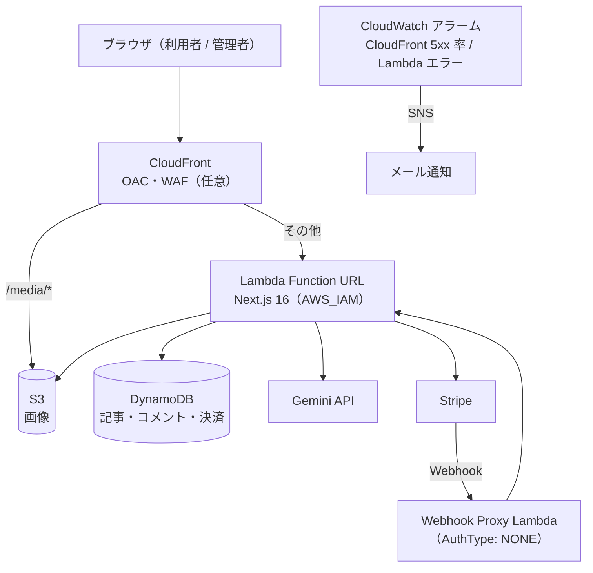

# homepage-v2

個人ブログ／メディアを **AWS サーバーレスで自前運用**するためのテンプレートです。
Google ログイン、AI による記事の生成・修正、Stripe の会員課金、コメント、画像配信、障害監視までを含みます。


| 項目 | 内容 |
|---|---|
| 公開しているサイトの例 | [okamoのhomepage](https://www.okamomedia.tokyo) |
| アプリ | Next.js 16（App Router）/ React 19 / TypeScript |
| ホスティング | CloudFront（OAC）+ Lambda Function URL（`AWS_IAM`・コンテナイメージ） |
| データ | DynamoDB（記事・コメント・決済）/ S3（画像、`/media/*`） |
| 認証 | 利用者は Google ログイン（OAuth 2.0 PKCE）、管理者は Cognito（2FA） |
| AI | Gemini（記事の生成・修正） |
| 課金 | Stripe（Checkout / Webhook） |
| 監視 | CloudWatch アラーム（CloudFront 5xx 率 / Lambda エラー）→ メール通知 |
| ライセンス | [Unlicense](LICENSE)（パブリックドメイン） |

**バージョン:** [Releases](https://github.com/okamoto53515606/homepage/releases) を参照（管理画面サイドバー下部と、セットアップ画面のヘッダにも表示されます）。

## あなたはどれ？

| 目的 | 最初に読むもの |
|---|---|
| 自分の PC で動かしたい（プログラミング不要・Windows 11） | [インストーラでセットアップ画面を起動する](https://github.com/okamoto53515606/homepage-v2-installer/blob/main/docs/installer-setup.md) |
| すでに使っていて最新版にしたい | [インストーラでアップデートする](https://github.com/okamoto53515606/homepage-v2-installer/blob/main/docs/installer-update.md) |
| コードを触る／改造する | [開発時の運用フロー](docs/operations_v2.md) |
| 設計・DB・環境変数を知りたい | [設計書](docs/blueprint_v2.md) / [DB 設計](docs/database-schema.md) / [環境変数](docs/secrets-and-env_v2.md) |
| 配布用 WSL イメージを作る（メンテナ向け） | [docs/wsl.md](docs/wsl.md) |

## 全体構成



> **why:** CloudFront からオリジンへは SigV4 署名（OAC）で送り、Lambda Function URL は `AWS_IAM` で外部から直接叩けないようにしています。Stripe Webhook だけは署名検証を持つため、`AuthType: NONE` の Proxy Lambda を経由させています。アラームは CloudFront と Lambda のメトリクスを直接監視するため、Lambda が一度も起動しない障害（イメージ欠損など）も検知できます。

## セットアップ（利用者）

Windows 11 の PC で、**インストーラ → セットアップ画面**の順に進めます。所要時間は 1〜2 時間（AWS と Stripe の画面操作を含む）。

1. [homepage-v2-installer の Releases](https://github.com/okamoto53515606/homepage-v2-installer/releases/latest) から `homepage-v2-installer-setup.zip` を入手して実行する（WSL2 イメージの取得・取り込みまで自動）
2. タスクトレイのアイコン →「起動 (npm run dev)」→ ブラウザで `http://localhost:3001/setup0` が開く
3. 画面の Step 0 から順に進める

| 手順書 | 内容 |
|---|---|
| [Part 1](docs/setup1.md) | AWS アカウントの準備 → CloudFront ドメインでサイト公開、Google ログインと Gemini の有効化 |
| [Part 2](docs/setup2.md) | Stripe サンドボックスで決済をテスト、独自ドメインの紐付け |
| [Part 3](docs/setup3.md) | Stripe の本番化（実カードでの課金） |

> インストーラの画面付き手順は [installer-setup.md](https://github.com/okamoto53515606/homepage-v2-installer/blob/main/docs/installer-setup.md)。停止・アンインストール・トラブルシューティングは [homepage-v2-installer](https://github.com/okamoto53515606/homepage-v2-installer) を参照してください。

## アップデート

**「WSL 内のアプリ」と「AWS 上で動いているサイト」は別物**で、更新も別の操作になります。

| 更新したいもの | 操作 | 所要 |
|---|---|---|
| WSL 内のアプリ（セットアップ画面のコード） | タスクトレイ →「アプリを更新...」 | 5〜20 分 |
| 公開サイト（AWS 上で動いているもの） | セットアップ画面 →「運用メニュー」→「アプリコード更新」 | 数分 |
| 構造変更（DynamoDB の GSI 追加・新規 Lambda・IAM 変更など） | セットアップ画面 → `setup1b` →「デプロイ」 | 30〜60 分 |
| インストーラ本体 | 新しい `homepage-v2-installer-setup.zip` で上書き | 数分 |

- 画面付きの手順: [installer-update.md](https://github.com/okamoto53515606/homepage-v2-installer/blob/main/docs/installer-update.md)
- 変更種別ごとの分岐・手動で差し替える場合: [docs/update_v2.md](docs/update_v2.md)

## 開発

```bash
git clone https://github.com/okamoto53515606/homepage.git
cd homepage
npm ci
cp env_template.txt .env     # 値を埋める（docs/secrets-and-env_v2.md）
npm run dev                  # http://localhost:9002
npm test                     # Vitest（Route Handler の認証・入力検証など）
npm run lint
npm run typecheck
```

- 必要なもの: Node.js 24、Docker（Lambda のコンテナイメージをビルドするとき）
- 実装ルール（`"use server"` 禁止・DELETE に body を付けない・DB 参照ページは `force-dynamic` など）と、その理由は [.github/copilot-instructions.md](.github/copilot-instructions.md) に集約しています

## 注意（事故防止）

| 禁止・注意 | 理由 |
|---|---|
| `npx cdk deploy` を単体で実行しない | CDK は `.env` を読まないため `--context` が空のまま適用され、独自ドメイン・WAF・Cognito・JWT シークレットが上書きされる。構造変更は必ず `setup1b` から |
| 使わない WAF は destroy する | WebACL は存在するだけで月 約 $5。`wafMode='none'` でも残置スタックは課金され続ける |
| AWS の課金は従量制 | CloudFront / Lambda / DynamoDB / S3 は無料枠の外で課金される。個人サイト規模なら小さいが、監視・ログも含めて把握しておく |

## ドキュメントマップ

| やりたいこと | ドキュメント |
|---|---|
| 全体設計・技術選定の理由 | [docs/blueprint_v2.md](docs/blueprint_v2.md) |
| テーブル設計 | [docs/database-schema.md](docs/database-schema.md) |
| 環境変数・シークレットの扱い | [docs/secrets-and-env_v2.md](docs/secrets-and-env_v2.md) |
| 日常の変更フロー（`/ops` か `setup1b` か） | [docs/operations_v2.md](docs/operations_v2.md) |
| 障害時の切り分け（502 など） | [docs/operations_v2.md](docs/operations_v2.md) の「障害時の切り分け」 |
| 配布用 WSL イメージの作成・公開 | [docs/wsl.md](docs/wsl.md) |
| セキュリティテスト（DAST / ZAP） | [docs/20260503_dast-zap-initial-scan.md](docs/20260503_dast-zap-initial-scan.md) |
| 過去の設計（v1） | [docs/blueprint.md](docs/blueprint.md) |
| 連携システム | [okamoちゃんねる](https://github.com/okamoto53515606/channel) |

## ライセンス

[Unlicense](LICENSE)（パブリックドメイン）。自己責任でご利用ください。

## 更新履歴

- 2026/04/25 [okamoのhomepage](https://www.okamomedia.tokyo) を homepage-v2 に切り替え（v1 → v2 の経緯は [docs/blueprint_v2.md](docs/blueprint_v2.md)）
- 以降の変更は [Releases](https://github.com/okamoto53515606/homepage/releases) を参照
